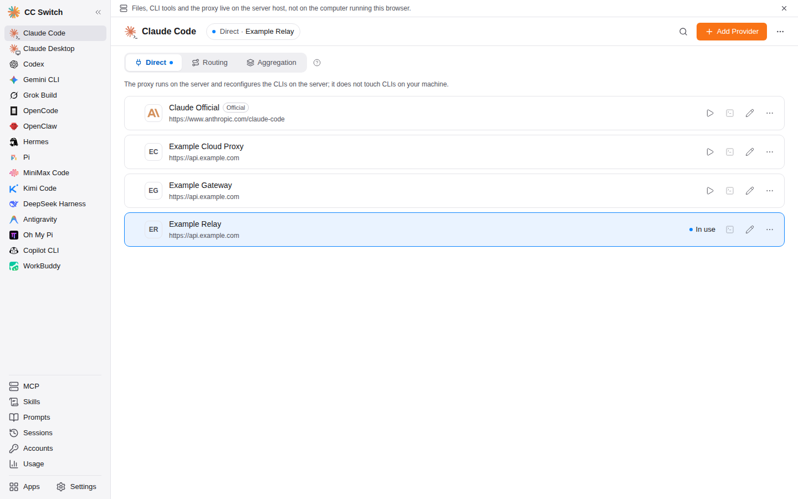

# cc-switch-web

The cc-switch console for servers without a desktop: manage the providers, MCP servers and skills of Claude Code, Codex, Gemini CLI and other coding agents from your browser.

[](https://github.com/alxwlw/cc-switch-web/releases)
[](https://github.com/alxwlw/cc-switch-web/actions/workflows/ci.yml)
[](LICENSE)



## Quick start

The console runs as the user your agents run as and edits that user's agent configs. It has no login of its own and listens on `127.0.0.1`, so you reach it through an SSH tunnel (or a tailnet, below).

**Release install (systemd user service)**

```bash
# On the server, as the user your agents run as:
curl -fsSL https://github.com/alxwlw/cc-switch-web/releases/latest/download/install.sh | bash
# On your laptop:
ssh -L 18766:localhost:18766 you@your-server   # then open http://localhost:18766
```

**Docker Compose**

```bash
curl -fsSLO https://raw.githubusercontent.com/alxwlw/cc-switch-web/main/deploy/compose.yml
printf 'CCS_UID=%s\nCCS_GID=%s\n' "$(id -u)" "$(id -g)" > .env
docker compose up -d
# on your laptop: ssh -L 18766:localhost:18766 you@server, then open http://localhost:18766
```

**Tailscale instead of a tunnel**

```bash
curl -fsSL https://github.com/alxwlw/cc-switch-web/releases/latest/download/install.sh | bash -s -- --tailscale
```

Open the address the installer prints. `--port N` changes the port (default 18766).

## Based on cc-switch

cc-switch-web is based on [farion1231/cc-switch](https://github.com/farion1231/cc-switch), the desktop app by Jason Young and its contributors, and could not exist without it. This fork runs the same app in a browser on a Linux server, and it is synchronized with the upstream project regularly. For the desktop app, its documentation and its issues, go to upstream.

## What works and what does not

The console manages files on the server host only. Providers, MCP servers, prompts, skills, sessions, usage, proxy settings, backups, import and export, and the sign-in flows of the managed accounts work in the browser.

What needs a desktop session is not there:

- the system tray and the tray panel, the application window controls, launch at login and silent start;
- native file pickers and file dialogs (the console uploads and downloads files through the browser instead) and "reveal in file manager" (it shows the server path to copy);
- opening a terminal for a provider or a session on the host, and the Hermes dashboard launcher;
- registering the `ccswitch://` link handler in the OS (deep-link import works by paste or upload);
- signing in to Antigravity, which needs a loopback callback on the host.

The same list comes from the server: `GET /api/capabilities` returns it in `runtime_boundaries`.

## Updating

Settings → About checks the latest release and shows what is new. A release install lets the console update itself from there with the "Update now" button; to turn that off, re-run the installer with `--no-self-update`.

To update by hand, run the installer again. It keeps the address, port and self-update setting of the installed unit:

```bash
curl -fsSL https://github.com/alxwlw/cc-switch-web/releases/latest/download/install.sh | bash
```

Docker: `docker compose pull && docker compose up -d`. `--version vX.Y.Z-web.N` installs a specific release.

## Uninstalling

```bash
curl -fsSL https://github.com/alxwlw/cc-switch-web/releases/latest/download/install.sh | bash -s -- --uninstall
```

The data in `~/.cc-switch-web` is kept; delete it by hand if you do not need it. With Docker: `docker compose down`.

## Security

The server has no login: whoever reaches its port controls the agent configs of that user and can start an update to a published release. Keep it on `127.0.0.1` behind an SSH tunnel, or on a tailnet with ACLs, and never publish the port. See [SECURITY.md](SECURITY.md) for the threat model and how to report a vulnerability.

## Building from source

See [CONTRIBUTING.md](CONTRIBUTING.md) and [docs/deploy.md](docs/deploy.md).

## License

[MIT](LICENSE)
